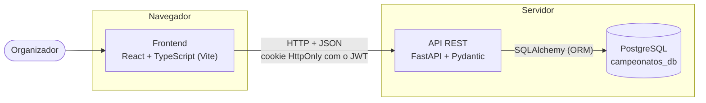

<div align="center">

# Nexum — Gerenciamento de Campeonatos Amadores de Futebol

Sistema web para organizar campeonatos amadores de futebol: o organizador cria o campeonato, cadastra os times e jogadores, gera o calendário de partidas e registra a súmula de cada jogo. O placar e a classificação são sempre calculados a partir dos eventos das partidas, nunca digitados.


Projeto da disciplina **Laboratório de Engenharia de Software** · FATEC São José dos Campos

</div>

---

## Sumário

- [Funcionalidades](#funcionalidades)
- [Requisitos](#requisitos)
- [Entregáveis](#entregáveis)
- [Tecnologias](#tecnologias)
- [Arquitetura](#arquitetura)
- [Design Patterns](#design-patterns)
- [Modelagem de dados](#modelagem-de-dados)
- [Como rodar](#como-rodar)
- [Testes](#testes)
- [Estrutura do repositório](#estrutura-do-repositório)
- [Organização do trabalho](#organização-do-trabalho)
- [Integrantes](#integrantes)

## Funcionalidades

| Tela | Rota | O que dá para fazer |
| --- | --- | --- |
| Início | `/` | Apresentação do sistema e acesso ao login |
| Login e cadastro | `/login`, `/cadastro` | Cria a conta e entra com e-mail e senha (JWT em cookie HttpOnly) |
| Campeonatos | `/campeonatos` | Lista, busca e filtra por status; cria, edita, encerra, reabre e exclui campeonatos |
| Detalhe do campeonato | `/campeonatos/:id` | Times e elenco, partidas, súmula e classificação do campeonato |

Dentro do detalhe do campeonato:

- **Times e jogadores:** cadastro, edição e exclusão dos times e do elenco de cada um
- **Partidas:** agendamento com aviso de conflito de horário e local na hora, geração automática do calendário (todos contra todos, com opção de ida e volta), navegação por rodada, remarcação, finalização, reabertura e exclusão
- **Súmula:** lançamento de gols e cartões por jogador e minuto, com o placar calculado automaticamente
- **Classificação:** tabela com pontos, jogos, vitórias, empates, derrotas e saldo de gols, atualizada assim que uma partida é finalizada

Em toda a interface há skeletons durante o carregamento e toasts de confirmação e erro.

<!-- prints das telas -->

## Requisitos

### Entrega 1

| Requisito | Situação | Onde |
| --- | --- | --- |
| RF — Criar campeonatos, cadastrar times e jogadores | ✅ | Telas de campeonatos, times e elenco |
| RF — Agendar partidas sem conflito de horário/local ou de time | ✅ | Agendamento e calendário, com aviso de conflito na hora |
| RF — Registrar placares e eventos das partidas | ✅ | Súmula, com o placar calculado pelos gols |
| RF — Gerar a tabela de classificação | ✅ | Classificação, atualizada ao finalizar cada partida |
| RNF — Restrições UNIQUE e validação transacional | ✅ | `UNIQUE` e `CHECK` no banco e rollback em `core/transacao.py` |
| RNF — Builder Pattern na geração do calendário | ✅ | `services/calendario_builder.py` |
| RNF — Service Layer | ✅ | Regras de negócio em `services/` |
| RNF — Bloqueio de conflitos de agenda no backend | ✅ | `partida_service.py` e `UNIQUE (data_hora, local)` |
| RNF — Tabela ordenada por pontos e saldo de gols | ✅ | `services/classificacao_service.py` |

### Entrega 2

| Requisito | Situação | Onde |
| --- | --- | --- |
| JWT em cookie HttpOnly (sem `localStorage`) | ✅ | `routers/auth_router.py` · `frontend/src/api/client.ts` |
| Skeletons durante o carregamento | ✅ | `components/ui/Skeleton.tsx` |
| Toasts de confirmação e erro | ✅ | `components/ui/ToastProvider.tsx` |
| Feedback visual imediato de conflito de agenda | ✅ | `components/partidas/AgendarPartidaModal.tsx` |
| Tabela de classificação | ✅ | `components/classificacao/ClassificacaoSection.tsx` |
| Súmula interativa (gols e cartões) | ✅ | `components/partidas/SumulaModal.tsx` |
| Geração do calendário com o Builder Pattern | ✅ | `components/partidas/GerarCalendarioModal.tsx` · `services/calendario_builder.py` |
| DER e diagrama de arquitetura atualizados | ✅ | [docs/DER.md](docs/DER.md) · [docs/ARQUITETURA.md](docs/ARQUITETURA.md) |

## Entregáveis

| Entregável | Situação | Onde |
| --- | --- | --- |
| Backend em Python (API REST) | ✅ | [`backend/`](backend/) · rotas em [backend/README.md](backend/README.md#principais-rotas) |
| Frontend em React + TypeScript | ✅ | [`frontend/`](frontend/) |
| Banco relacional PostgreSQL | ✅ | [Modelagem de dados](#modelagem-de-dados) |
| Modelagem de dados (DER) | ✅ | [docs/DER.md](docs/DER.md) |
| Desenho de arquitetura | ✅ | [docs/ARQUITETURA.md](docs/ARQUITETURA.md) |
| Docker | ✅ PostgreSQL, backend e frontend | [Como rodar](#como-rodar) · `docker-compose.yml` |
| Design Patterns | ✅ Builder, Service Layer e Dependency Injection | [Design Patterns](#design-patterns) |
| Testes automatizados e CI | ✅ 119 testes no GitHub Actions | [Testes](#testes) |
| Repositório Git (branches, PRs, Conventional Commits) | ✅ | [Organização do trabalho](#organização-do-trabalho) |
| Backlog | ✅ | [docs/BACKLOG.MD](docs/BACKLOG.MD) · [Jira](https://matheusdisabatino.atlassian.net/jira/software/projects/FUT/boards/2) |

## Tecnologias

| Camada | Tecnologia |
| --- | --- |
| Backend | Python 3.13, FastAPI, SQLAlchemy, Pydantic |
| Frontend | React 19, TypeScript, Vite, React Router, CSS Modules |
| Banco de dados | PostgreSQL |
| Autenticação | JWT (python-jose) em cookie HttpOnly, senhas com bcrypt |
| Testes e CI | pytest e GitHub Actions |
| Infraestrutura | Docker e Docker Compose (nginx servindo o frontend) |
| Metodologia | Kanban (Jira) |

## Arquitetura



A arquitetura completa, com as camadas do backend, a organização do frontend, o caminho de uma requisição e a implantação com Docker, está em [docs/ARQUITETURA.md](docs/ARQUITETURA.md).

- **Frontend:** uma SPA em React. As telas ficam em `pages/`, os pedaços reutilizáveis em `components/` e todas as chamadas HTTP em `api/`, que envia o cookie de login em toda requisição (`credentials: 'include'`).
- **Backend:** organizado em camadas. Os `routers` só recebem a requisição e chamam os `services`; os `services` concentram as regras de negócio; os `models` mapeiam as tabelas; os `schemas` validam a entrada e a saída.
- **Banco:** PostgreSQL, com restrições `UNIQUE` e `CHECK` reforçando as regras que os services já validam.

Fluxo de uma requisição: o React chama `api/partidas.ts` → `POST /api/campeonatos/{id}/partidas` → o `Depends(get_current_user)` lê o JWT do cookie → o `partida_service` valida times e conflitos → grava pelo `salvar()` (commit ou rollback) → a resposta volta e a tela mostra o toast.

## Design Patterns

### Builder

A geração automática do calendário usa o `CalendarioBuilder` ([`calendario_builder.py`](backend/app/services/calendario_builder.py)). Cada parâmetro é configurado por um método que devolve o próprio builder (interface fluente), e o `build()` valida e monta as partidas no esquema todos contra todos:

```python
partidas = (
    CalendarioBuilder()
    .set_times([1, 2, 3, 4])
    .set_local("Quadra Central")
    .set_data_inicio(date(2026, 3, 1))
    .set_horario(time(15, 0))
    .set_ida_e_volta(True)
    .build()
)
```

O builder não acessa o banco: o `calendario_service` confere conflitos com as partidas já existentes e grava tudo ou nada.

### Service Layer

Toda regra de negócio fica em `backend/app/services/` (conflito de agenda, posse do campeonato, campeonato encerrado, partida finalizada, cálculo da classificação). Os routers não têm regra nenhuma, o que deixa as regras testáveis sem subir a API.

### Dependency Injection

O FastAPI injeta as dependências de cada rota com `Depends()`: a sessão do banco (`get_db`) e o usuário logado (`get_current_user`, que lê e valida o JWT do cookie). Nos testes, a sessão é trocada por um banco SQLite em memória sem mudar o código das rotas.

## Modelagem de dados

O DER completo, com o diagrama, as colunas, os relacionamentos e as restrições, está em [docs/DER.md](docs/DER.md).

Tabelas: `usuarios`, `campeonatos`, `times`, `jogadores`, `partidas` e `eventos_partida`. Cada organizador tem seus campeonatos; cada campeonato tem times e partidas; cada time tem jogadores; cada partida tem um time mandante, um visitante e os eventos (gols e cartões) lançados na súmula.

Restrições no banco:

- `UNIQUE (data_hora, local)` em `partidas`: duas partidas não ocupam o mesmo local no mesmo horário
- `CHECK (time_mandante_id <> time_visitante_id)`: um time não joga contra ele mesmo
- `CHECK (minuto IS NULL OR minuto >= 0)` em `eventos_partida`
- `UNIQUE (email)` em `usuarios`

O placar não é uma coluna: é calculado pelos eventos do tipo gol, e a classificação considera só as partidas finalizadas.

## Como rodar

### Com Docker (recomendado)

Com o Docker Desktop aberto, na raiz do repositório:

```bash
docker compose up --build
```

Sobem três containers: PostgreSQL, backend e frontend. Acesse `http://localhost:5173`; a documentação da API fica em `http://localhost:8000/docs`. As tabelas são criadas sozinhas e os dados ficam no volume `dados_postgres`, então sobrevivem a um `docker compose down` (use `docker compose down -v` para apagar o banco).

| Variável (opcional) | Padrão | Uso |
| --- | --- | --- |
| `POSTGRES_PASSWORD` | `postgres` | Senha do banco |
| `SECRET_KEY` | `chave-secreta-jwt-trocar-em-producao` | Assinatura do JWT |
| `DB_PORT` | `5432` | Porta do banco na máquina, se a 5432 já estiver em uso |

As portas 5173 e 8000 precisam estar livres: desligue outros projetos que usem essas portas antes de subir.

### Sem Docker

O backend e o frontend rodam separados, cada um em um terminal. Instruções completas em [backend/README.md](backend/README.md) e [frontend/README.md](frontend/README.md).

```bash
# 1. API → http://localhost:8000 (documentação interativa em /docs)
cd backend
python -m venv venv
venv\Scripts\activate
pip install -r requirements.txt
uvicorn app.main:app --reload
```

```bash
# 2. Frontend → http://localhost:5173
cd frontend
npm install
npm run dev
```

O backend precisa de um banco `campeonatos_db` no PostgreSQL; para não instalar o PostgreSQL, dá para subir só o banco pelo Docker com `docker compose up db`. As tabelas são criadas automaticamente na primeira execução. Depois é só criar uma conta em `/cadastro`.

## Testes

```bash
cd backend
pytest -v
```

São 119 testes com pytest, usando um banco SQLite em memória (não precisam do PostgreSQL):

- **Services:** conflito de agenda, Builder do calendário, classificação, eventos e placar, partida finalizada, campeonato encerrado, regras de times e jogadores, rollback de transação
- **API:** rotas pelo `TestClient`, login com cookie e isolamento entre organizadores

O GitHub Actions ([`testes.yml`](.github/workflows/testes.yml)) roda todos os testes a cada push e Pull Request para a `dev` e a `main`.

## Estrutura do repositório

```text
.
├── backend/
│   ├── app/
│   │   ├── models/     entidades e tabelas
│   │   ├── schemas/    validação de entrada e saída (Pydantic)
│   │   ├── services/   regras de negócio e Builder do calendário
│   │   ├── routers/    endpoints da API
│   │   └── core/       JWT, usuário logado e controle de transação
│   └── tests/          testes com pytest
├── frontend/
│   └── src/
│       ├── api/        chamadas à API
│       ├── components/ componentes reutilizáveis e seções das telas
│       ├── layouts/    estrutura das telas
│       └── pages/      telas
├── docs/               backlog, DER e arquitetura
├── .github/            CI e template de Pull Request
└── docker-compose.yml  sobe banco, backend e frontend
```

## Organização do trabalho

- Backlog no [Jira](https://matheusdisabatino.atlassian.net/jira/software/projects/FUT/boards/2), com épicos e user stories ([BACKLOG.MD](docs/BACKLOG.MD)).
- Uma branch por tarefa, saindo da `dev`, com prefixo `front/` ou `back/`.
- Integração por Pull Request para a `dev`, seguindo o [template](.github/pull_request_template.md), com revisão do outro integrante e os testes do CI passando.
- A cada entrega, a `dev` é mergeada na `main`.
- Commits no padrão Conventional Commits (`feat`, `fix`, `refactor`, `docs`, `chore`).

## Integrantes

| Nome | GitHub |
| --- | --- |
| Matheus Di Sabatino Pires | [@matheuspires7](https://github.com/matheuspires7) |
| Celso Moreira Freitas | [@yCels](https://github.com/yCels) |

**FATEC São José dos Campos** — Análise e Desenvolvimento de Sistemas
