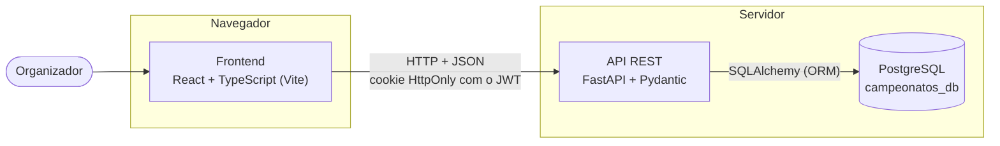
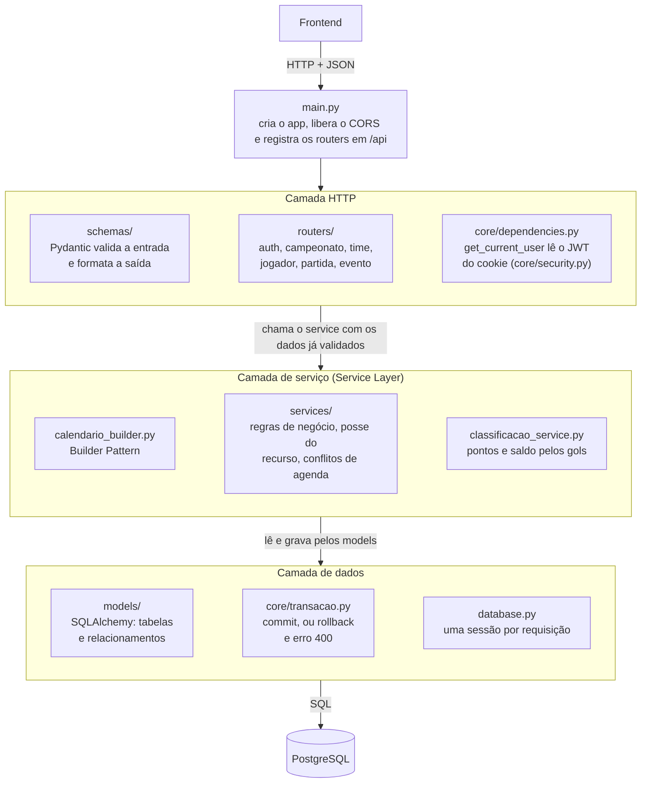
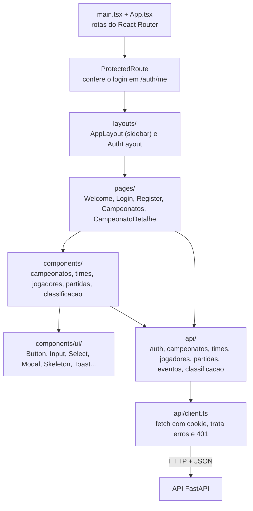
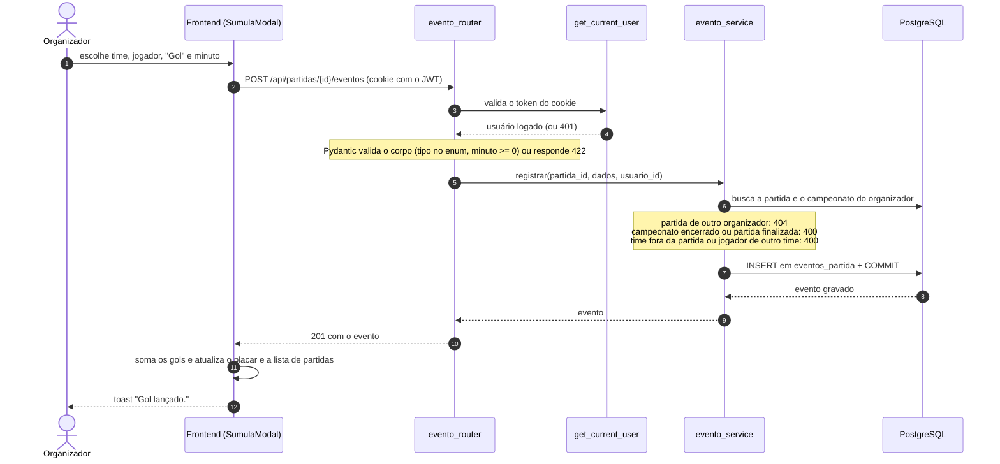
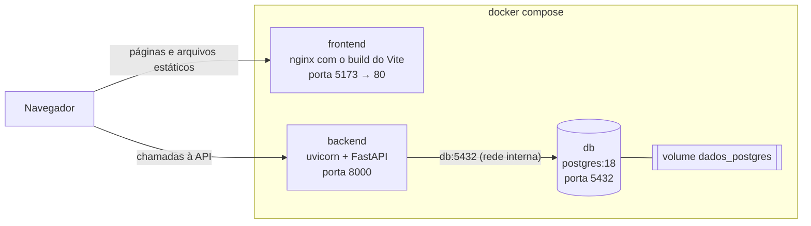

# Arquitetura

O Nexum é uma aplicação web em três partes: uma interface em React que roda no navegador, uma API REST em FastAPI e um banco PostgreSQL. O frontend nunca acessa o banco: toda leitura e gravação passa pela API, que concentra as regras de negócio.

## Visão geral

| Parte | Tecnologia | Responsabilidade |
| --- | --- | --- |
| Frontend | React 19, TypeScript, Vite, React Router, CSS Modules | Telas, navegação, validação dos formulários e feedback (skeletons e toasts) |
| API | Python, FastAPI, Pydantic, SQLAlchemy | Autenticação, regras de negócio, validação e cálculo de placar e classificação |
| Banco | PostgreSQL | Persistência e restrições de integridade (UNIQUE, CHECK e chaves estrangeiras) |

### Autenticação

No login, a API devolve o JWT num **cookie HttpOnly**. O JavaScript da página não consegue ler esse cookie, e o navegador o envia sozinho em toda requisição (`credentials: 'include'`). O token não fica no `localStorage`. O CORS do backend libera só a origem do frontend (`http://localhost:5173`), com `allow_credentials`.

## Backend em camadas

Cada requisição atravessa as camadas sempre na mesma ordem. O router não tem regra de negócio, e o service não sabe nada de HTTP além de lançar `HTTPException`.

| Camada | Pasta | O que faz |
| --- | --- | --- |
| Routers | `routers/` | Declaram os endpoints, recebem a sessão do banco e o usuário logado por `Depends` e chamam o service |
| Schemas | `schemas/` | Pydantic valida o corpo da requisição (422 se inválido) e define o formato da resposta |
| Services | `services/` | Toda regra de negócio: o recurso precisa ser do organizador logado (senão 404), conflitos de agenda, campeonato encerrado, partida finalizada |
| Models | `models/` | Mapeamento das tabelas; o DER está em [DER.md](DER.md) |
| Core | `core/` | Segurança (hash e JWT), dependência de autenticação e gravação transacional |

### Padrões de projeto

- **Service Layer**: as regras ficam nos services, o que permite testá-las sem subir a API (`backend/tests/`).
- **Builder**: `CalendarioBuilder` monta o calendário passo a passo (`set_times`, `set_local`, `set_data_inicio`, `set_horario`, `set_intervalo_dias`, `set_duracao_jogo`, `set_ida_e_volta`), valida a configuração e só gera as partidas no `build()`. O `calendario_service` usa o builder e grava tudo numa transação só.
- **Injeção de dependência**: o FastAPI entrega a sessão do banco (`get_db`) e o usuário logado (`get_current_user`) para cada rota.

## Frontend

- Cada recurso da API tem um módulo em `src/api/` com funções tipadas; todos usam o `client.ts`, que monta a URL a partir de `VITE_API_URL`, envia o cookie e transforma o erro da API numa mensagem legível.
- Uma resposta 401 leva para a tela de login.
- O detalhe do campeonato reúne as seções de times, partidas e classificação; elenco, súmula e formulários abrem em modais.

## Exemplo de requisição: lançar um gol na súmula

Só os eventos de partidas com `finalizada = true` entram na classificação, que é recalculada a cada consulta em `GET /api/campeonatos/{id}/classificacao`.

## Implantação com Docker

O `docker-compose.yml` na raiz sobe as três partes em containers:

- O navegador chama a API direto em `localhost:8000`: o nginx só serve os arquivos do frontend.
- O backend espera o banco aceitar conexões (healthcheck) antes de subir e cria as tabelas na inicialização.
- Os dados ficam no volume `dados_postgres` e sobrevivem a um `docker compose down`.
