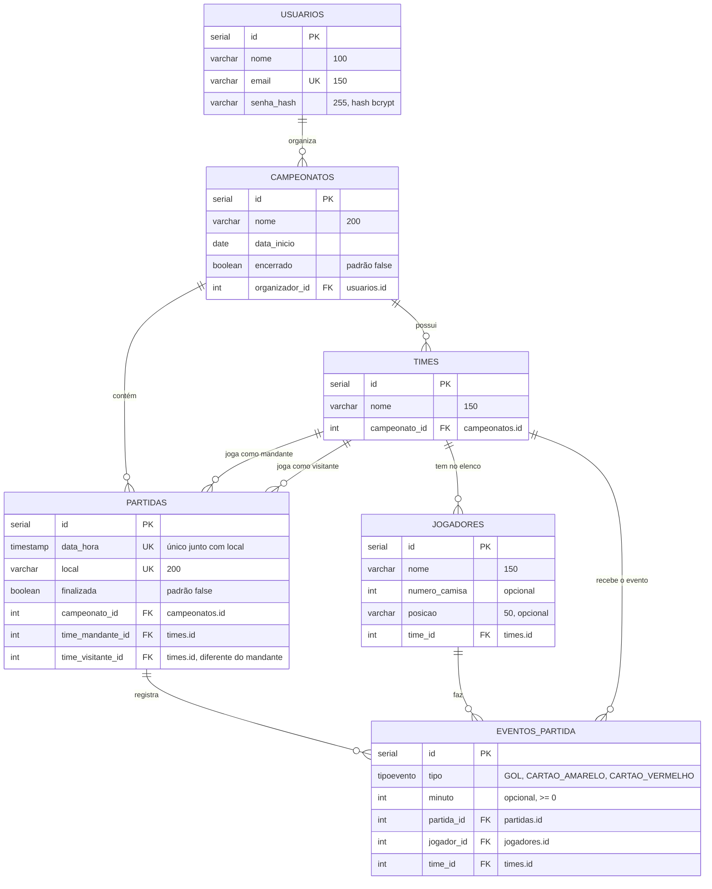

# DER — Diagrama Entidade-Relacionamento

Modelo do banco PostgreSQL do Nexum. As tabelas são criadas pelo SQLAlchemy a partir dos models em [`backend/app/models/`](../backend/app/models/), então este diagrama segue exatamente o que está no código.

## Diagrama

## Tabelas

Todas as colunas são `NOT NULL`, exceto as marcadas como opcionais.

| Tabela | O que guarda | Colunas |
| --- | --- | --- |
| `usuarios` | Organizadores (quem faz login) | `id`, `nome`, `email` (único), `senha_hash` |
| `campeonatos` | Campeonatos de um organizador | `id`, `nome`, `data_inicio`, `encerrado`, `organizador_id` |
| `times` | Times inscritos em um campeonato | `id`, `nome`, `campeonato_id` |
| `jogadores` | Elenco de um time | `id`, `nome`, `numero_camisa` (opcional), `posicao` (opcional), `time_id` |
| `partidas` | Jogos agendados entre dois times do campeonato | `id`, `data_hora`, `local`, `finalizada`, `campeonato_id`, `time_mandante_id`, `time_visitante_id` |
| `eventos_partida` | Súmula: gols e cartões de cada jogo | `id`, `tipo`, `minuto` (opcional), `partida_id`, `jogador_id`, `time_id` |

## Relacionamentos

| Relação | Cardinalidade | Observação |
| --- | --- | --- |
| Usuário → Campeonato | 1 : N | Cada organizador só enxerga os próprios campeonatos |
| Campeonato → Time | 1 : N | O time pertence a um único campeonato |
| Campeonato → Partida | 1 : N | |
| Time → Jogador | 1 : N | |
| Time → Partida | 1 : N, duas vezes | Uma FK para o mandante e outra para o visitante |
| Partida → Evento | 1 : N | |
| Jogador → Evento | 1 : N | O jogador precisa ser do time do evento (validado no service) |
| Time → Evento | 1 : N | Guarda o time do evento para contar os gols de cada lado sem cruzar com o elenco |

## Restrições de integridade

| Restrição | Tabela | Regra |
| --- | --- | --- |
| `ix_usuarios_email` — índice `UNIQUE (email)` | `usuarios` | Um email por conta |
| `uq_partidas_data_hora_local` — `UNIQUE (data_hora, local)` | `partidas` | Duas partidas não podem acontecer no mesmo horário e local |
| `ck_partidas_times_diferentes` — `CHECK (time_mandante_id <> time_visitante_id)` | `partidas` | Um time não joga contra ele mesmo |
| `ck_eventos_minuto_positivo` — `CHECK (minuto IS NULL OR minuto >= 0)` | `eventos_partida` | Minuto não pode ser negativo |
| Chaves estrangeiras | todas | Não deixam excluir um time com partidas nem um jogador com eventos (a API responde 400) |

Quando uma dessas restrições é violada, `core/transacao.py` faz `rollback` e a API responde 400 com uma mensagem amigável.

## Dados que não são colunas

Alguns valores que a API devolve são calculados a partir das tabelas, e não guardados:

- **Placar da partida**: contagem dos eventos `GOL` de cada time (`gols_mandante` e `gols_visitante`).
- **Classificação**: pontos, vitórias, empates, derrotas e saldo, somados só das partidas com `finalizada = true`.
- **Totais do campeonato**: `total_times` e `total_partidas`.

## Exclusões em cascata

A cascata é feita pelo SQLAlchemy (`cascade="all, delete-orphan"`), e não por `ON DELETE CASCADE` no banco:

- Excluir um **campeonato** apaga os times e as partidas dele; as partidas apagam os eventos.
- Excluir um **time** apaga os jogadores, mas é recusado se o time já tiver partidas.
- Excluir uma **partida** apaga os eventos dela.
